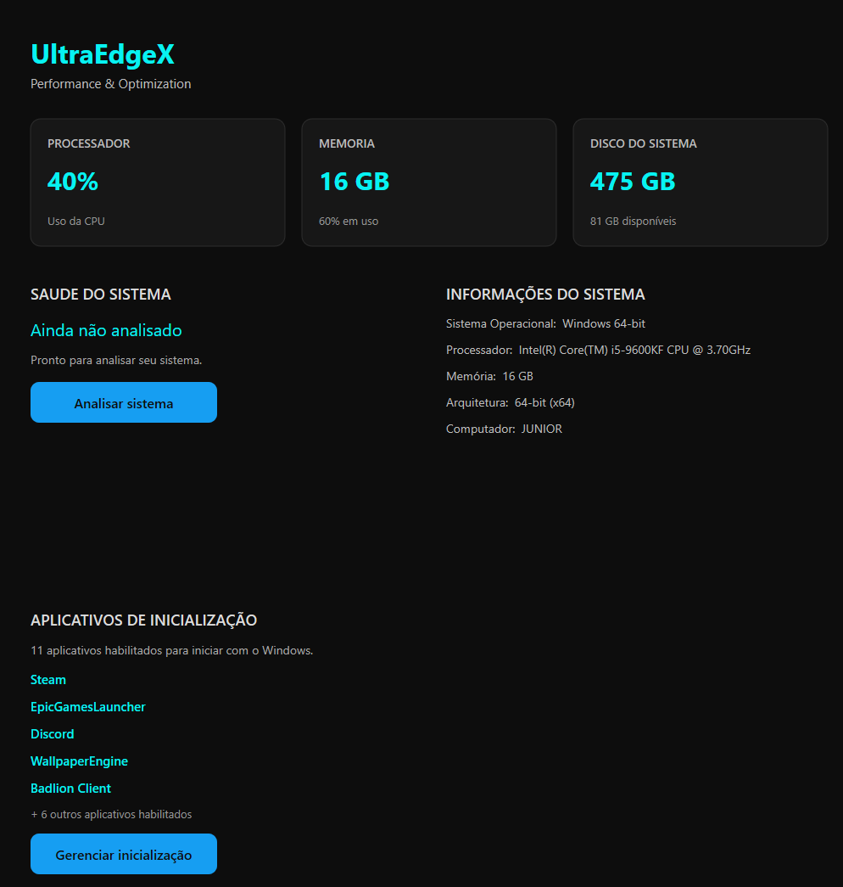

# UltraEdgeX

UltraEdgeX (UeX) é um software moderno para Windows focado em monitoramento, limpeza e otimização do sistema operacional, com explicações claras e confirmação antes de qualquer alteração.

## Status

🚧 Em desenvolvimento

## Preview

## Objetivos

- Segurança
- Transparência
- Performance
- Simplicidade

## Funcionalidades

- Painel com Health Score, informações do sistema e uso de CPU, memória e disco
- Limpeza de arquivos temporários e caches
- Serviços do Windows (lista segura, reversível)
- Inicialização: apps do Registro e da Microsoft Store
- Temas escuro e claro

Em desenvolvimento: Configurações e tela de Logs. O andamento está em `docs/07-Roadmap.md`.

## Documentação

Toda a documentação do projeto está disponível na pasta `docs/`.