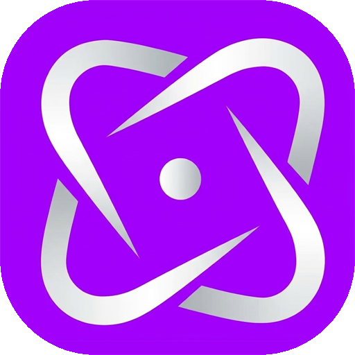

# Brand Guide

| Projeto | UltraEdgeX (UeX) |
|----------|----------------|
| Documento | Brand Guide |
| Versão | 1.1 |
| Status | Draft |
| Autor | Junior |
| Última atualização | Outubro/2026 |

---

# Índice

1. Identidade
2. Nome
3. Missão Visual
4. Logo
5. Paleta de Cores
6. Tipografia
7. Ícones
8. Estilo Visual
9. Componentes
10. Animações
11. Ilustrações
12. Tom do Produto

---

# 1. Identidade

O UltraEdgeX transmite tecnologia, confiança, desempenho e simplicidade.

O design deve parecer moderno sem exageros, priorizando clareza e organização.

---

# 2. Nome

Nome oficial:

**UltraEdgeX**

Abreviação na interface:

**UeX**

Uso:

• O nome completo, UltraEdgeX, aparece na barra de título da janela e em telas institucionais.

• Na interface do dia a dia aparece **UeX**.

Histórico:

"Real Optimizer" foi o nome provisório do projeto e continua só em nomes técnicos do código (namespace `real_optimizer` e a camada ROUI). Decisão registrada em DEC-012.

---

# 3. Missão Visual

Ao abrir o software o usuário deve perceber imediatamente que está utilizando uma aplicação profissional.

A interface deve transmitir:

• Organização

• Segurança

• Performance

• Modernidade

• Clareza

---

# 4. Logo

Arquivo:

O ícone do aplicativo fica em `assets/app.ico`.

Regras:

• Não alterar proporções.

• Não distorcer.

• Não aplicar efeitos exagerados.

• Sempre manter boa legibilidade.

---

# 5. Paleta de Cores

A fonte única dos valores é o tema do app (`roui/core/Theme.cpp`). A tabela completa, com todos os tokens, está no [UI Design System](05-UIDesignSystem.md).

### Cor Primária

Roxo `#AC00FF` (DEC-011).

Uso:

Botões principais.

Links.

Elementos ativos.

Barras e anel de progresso.

No tema escuro, textos em destaque usam `#C766FF`, para manter o contraste.

---

### Cor Secundária

Fundo suave da cor primária (`#1F1030` no escuro, `#F1E3FF` no claro).

Uso:

Item escolhido em menus.

Indicadores.

---

### Fundo Principal

Escuro `#0A0C0D` · Claro `#F4F7F8`

Uso:

Background da aplicação.

---

### Fundo Secundário

Escuro `#101517` (cards) e `#0D1012` (sidebar) · Claro `#FFFFFF`

Uso:

Sidebar.

Cards.

Menus.

---

### Texto Primário

Escuro `#E6EAEC` · Claro `#14181A`

Uso:

Títulos.

Informações importantes.

---

### Texto Secundário

Escuro `#9AA6AB` · Claro `#5B676C`

Uso:

Descrições.

Informações auxiliares.

---

### Verde

Escuro `#4ADE80` · Claro `#15803D`

Sucesso e nível **Seguro**.

---

### Amarelo

Escuro `#FBBF24` · Claro `#A16207`

Atenção e nível **Atenção**.

---

### Vermelho

Erro.

Ainda não há um token de vermelho no tema, porque nenhuma tela mostra estado de erro com cor própria. Será definido junto com a primeira tela que precisar.

---

### Azul

Informação.

Ainda sem token no tema, pelo mesmo motivo.

---

# 6. Tipografia

Fonte oficial prevista:

Inter

Fonte em uso hoje:

**Segoe UI**, a fonte do Windows. A troca para a Inter ainda não foi feita: ela exige embutir a fonte no app e carregá-la no DirectWrite. Até lá, o guia vale como destino e o app usa a Segoe UI.

Pesos utilizados no app:

Regular

SemiBold

Bold

Light e Medium não são usados.

Regras:

Títulos de página usam Bold; títulos de itens, valores e botões usam SemiBold; descrições usam Regular.

Não usar outros pesos além desses três.

---

# 7. Ícones

Estilo:

Outline

Minimalista

Consistente

Sem excesso de detalhes.

Todos os ícones devem seguir o mesmo conjunto visual.

Hoje a interface quase não usa ícones: os itens da barra lateral são só texto, e as marcas (check, seta) são desenhadas por linhas simples.

---

# 8. Estilo Visual

Minimalista.

Tecnológico.

Levemente gamer.

Sem aparência infantil.

Sem excesso de brilho.

Sem excesso de transparência.

Sem poluição visual.

O conteúdo deve sempre ter prioridade sobre os efeitos.

---

# 9. Componentes

Todos os componentes seguirão um mesmo padrão visual.

Exemplos:

Botões

Cards

Interruptores

Progress Bars e anel

Badges (Seguro / Atenção)

Menus (escolha de disco)

Dialogs (confirmação)

Os componentes existentes e as regras de cada um estão no [UI Design System](05-UIDesignSystem.md). Inputs de texto e tooltips ainda não existem.

---

# 10. Animações

As animações devem ser discretas.

Objetivos:

Guiar a atenção do usuário.

Melhorar a experiência.

Nunca distrair.

Nunca reduzir a performance.

---

# 11. Ilustrações

Sempre utilizar ilustrações simples.

Evitar imagens excessivamente chamativas.

O software deve parecer profissional.

---

# 12. Tom do Produto

O UeX deve conversar com o usuário de forma clara.

Exemplo:

Errado:

Erro 0x000001F.

Certo:

Não foi possível concluir esta otimização.

Verifique se você possui permissões de administrador.

---

Toda mensagem deverá ser escrita em linguagem simples.

Também vale para promessas: o UeX descreve o que o app faz e nunca promete ganho de desempenho que não possa medir.
